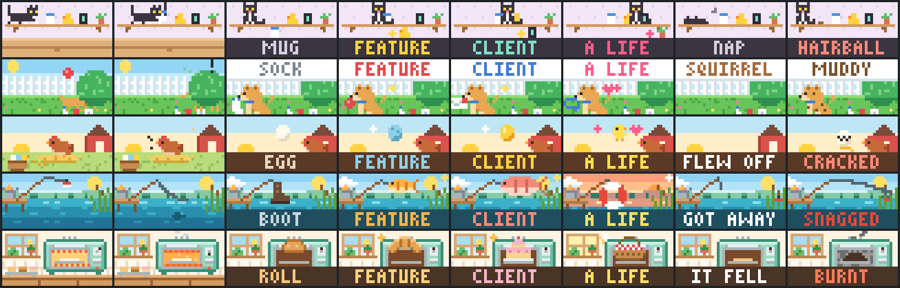

# Mind the Mug

**Don't delegate your reasoning. Or you'll get a mug.**

A kind reminder for Claude Code. Once a day, after the last response of a
turn, a small pixel-art cat shows up at the bottom-right of the screen, just
above the prompt, and knocks something off its shelf. Almost always the mug.
It stays there until you send your next prompt, and then it is gone until
tomorrow.

<p align="center"></p>

## The idea

1. **You can't control what the model returns.** The same prompt gives a
   different answer every time. You can ask well and still get the mug.
2. **You control what you delegate.** Which task, with what context, how
   much of it, and what you check before you accept the result.
3. **So delegate the work, never your reasoning.** Deciding what you want,
   why, and whether what came back is right is your part. Hand that over
   too, prompt again until something looks right, and you are not working
   any more. You are asking a cat for a feature.

The plugin is not a score and not a warning. It is a cat, once a day,
reminding you kindly which part of the work is yours.

Each mascot says it in its own words:

| Mascot | World | You can't pick… | You pick… | Delegate your reasoning and you get… |
| --- | --- | --- | --- | --- |
| `cat` (default) | **Shelf Life** · You can ask. The cat decides. | what falls | what goes on the shelf | a mug |
| `dog` | **Fetch** · Every throw comes back different. | what comes back | what you throw | a sock |
| `hen` | **Hatch** · Same hen, different egg. | the egg | what you feed her | a plain egg |
| `lake` | **Catch of the Day** · Same bait, different fish. | the fish | where you cast | an old boot |
| `oven` | **Proof** · Same recipe, different bake. | how it bakes | what goes in | a plain roll |

<p align="center"></p>

More in [docs/CONCEPT.md](docs/CONCEPT.md).

## What you see

Nothing while Claude works, and nothing for the responses in the middle of a
turn. When the turn ends with its last response, the mascot appears and
plays the turn back in a few seconds: you ask, it reacts once per tool call
(a paw tap, a rustle in the bush, a cluck), and then something comes back.
After that it holds still, with a few words beside it:

```
                    Shelf Life · the mug, again  ▀▀▀▀▀▀▀▀▀▀▀▀▀▀▀▀▀▀▀▀
                  You can ask. The cat decides.  ▀▀▀▀▀▀▀▀▀▀▀▀▀▀▀▀▀▀▀▀
                     You can't pick what falls.  ▀▀▀▀  40 × 10   ▀▀▀▀
               You pick what goes on the shelf.  ▀▀▀▀  cells of  ▀▀▀▀
                                                 ▀▀▀▀  pixels    ▀▀▀▀
                 Don't delegate your reasoning.  ▀▀▀▀▀▀▀▀▀▀▀▀▀▀▀▀▀▀▀▀
                           Or you'll get a mug.  ▀▀▀▀▀▀▀▀▀▀▀▀▀▀▀▀▀▀▀▀
```

and the turn's closing line in the transcript reads like

```
✻ Deliberated for 42s · the mug, again · 3 off the shelf
✻ Fetched in 1m 4s · a letter · CLIENT · 7 by the door
```

What comes back is rolled from a fixed, published table when the turn ends.
It has nothing to do with how good the answer was, on purpose: the cat does
not know whether you thought. The mug is a reminder, not a verdict.

| Comes back | Odds | cat | dog | hen | lake | oven |
| --- | --- | --- | --- | --- | --- | --- |
| nothing | 85% | the mug | a sock | a plain egg | an old boot | a roll |
| FEATURE | 10% | rubber duck | the ball | a blue egg | a perch | a croissant |
| CLIENT | 4% | the phone | a letter | a golden egg | a salmon | a cake |
| A LIFE | 1% | the plant | the leash | a chick | a life ring | a picnic basket |
| interrupted (Esc) | | it naps | squirrel! | she flies off | it got away | it fell |
| API error | | hairball | muddy | cracked | snagged | burnt |

Send the next prompt and the mascot leaves. There are no credits, no cost
per prompt, no score and no sound.

## Setup

There is nothing to set up: install it and the cat shows once a day. To
change it, type `/mascot` and the words you want, in any order:

```
/mascot                 show the current settings and every option
/mascot dog             a specific mascot: cat | dog | hen | lake | oven
/mascot random          a different one each time
/mascot always          after every answer, not once a day
/mascot daily           back to once a day (the default)
/mascot off             never
/mascot always random   both at once; "every prompt hen" and "once a day cat" work too
/mascot now             show it after the next answer, whatever the setting
/mascot reset           back to the defaults: daily, cat
```

| Setting | Values | Default |
| --- | --- | --- |
| When it shows | `daily` once a day, after the first answer of the day · `always` after every answer · `off` | `daily` |
| Mascot | `cat` · `dog` · `hen` · `lake` · `oven` · `random` | `cat` |

The same two settings are rows in Claude Code's `/config` menu under the
plugin (`show` and `mascot` in its `userConfig`), and are asked for when the
plugin is installed. Whichever you changed last wins.

Details of `daily`:

- It shows after the first turn of the day that ended with an answer. A turn
  you interrupted, or one that failed, has no last response: it neither
  shows the mascot nor uses up the day.
- The day is your local calendar day, and it is shared by every session on
  the machine: one mascot a day, not one per window.
- With `always`, interrupted and failed turns show too (the cat naps, the
  hairball).

## Requirements

- Claude Code **2.1.287 or newer** (mods are on by default; no environment
  variable). Validated against 2.1.321.
- A terminal with truecolor and a font that draws `▀` (U+2580) with full-cell
  coverage: iTerm2, Terminal.app, VS Code's terminal, kitty, WezTerm all do.
- At least 40 columns and 10 free rows above the prompt for the picture.
  From about 85 columns the words sit beside it; in a band too small for the
  picture you get one line: `✻ Shelf Life · the mug, again · Don't delegate
  your reasoning, or you'll get a mug.`

The plugin has **zero runtime dependencies**.

## Install

### From GitHub (recommended)

```
/plugin marketplace add WorldInnovationsDepartment/mind_the_mug
/plugin install mind-the-mug@mind-the-mug
```

### From a local checkout

```bash
git clone https://github.com/WorldInnovationsDepartment/mind_the_mug.git
claude --plugin-dir /path/to/mind_the_mug
```

or register the checkout as a local marketplace:

```
/plugin marketplace add /path/to/mind_the_mug
/plugin install mind-the-mug@mind-the-mug
```

Send a prompt; when Claude has answered, the cat is there. `ctrl+x ctrl+a`
collapses the band if you want it out of the way before your next prompt.

## Commands

| Command | What it does |
| --- | --- |
| `/mascot [cat\|dog\|hen\|lake\|oven\|random] [daily\|always\|off] [now]` | Shows or changes the two settings (see Setup). |
| `/mind-the-mug:demo [mascot\|all] [none\|feature\|client\|life\|abort\|error]` | Previews a mascot without waiting for a turn, using the same engine. Never touches the record. |
| `/mind-the-mug:stats` | Prints what has come back so far, from the persisted store. Read-only, and not a score. |

The last two can be run directly: `node bin/demo.js dog life` (animated in a
real terminal), `node bin/demo.js all`, `node bin/stats.js`.

## Repository layout

```
.claude-plugin/     plugin.json (the two settings), marketplace.json, icon.png
hooks/mug.js      the mod module: the only file that touches the engine ($)
lib/
  mascots.js        the five mascots and every word they say
  scenes/*.js       cat, dog, hen, lake, oven: one draw(buffer, state, now) each
  pixels.js         the 40 x 20 pixel buffer, a 3x5 font, small maths
  show.js           one showing: timeline, frame, turn line, caption
  rng.js            the odds table and the seeded roll
  mod-helpers.js    settings, /mascot grammar, the once-a-day rule, the record, band layout
  frame.js, width.js, render-tree.js, render-ansi.js   Frame model and its two renderers
bin/demo.js         /mind-the-mug:demo
bin/stats.js        /mind-the-mug:stats
commands/           the two file commands (/mascot is registered by the mod itself)
tests/              node --test
scripts/dev/        readme-hero.js, contact-sheet.js, pty-smoke.py, make-music-v3.js, verify-launch-v3.py
docs/               CONCEPT.md, ARCHITECTURE.md, ART-SPEC.md, hero.svg, mascots.png
art/                Remotion project of the launch video (see below)
openspec/           specs
```

## Development

```bash
claude plugin validate .               # manifest, marketplace and mod module: must pass with zero errors
node --test tests/*.test.js            # scenes, timeline, odds, settings, once-a-day rule, the hooks end to end
node bin/demo.js cat life              # watch one showing in your terminal
node scripts/dev/contact-sheet.js      # regenerate docs/mascots.png and .claude-plugin/icon.png
node scripts/dev/readme-hero.js        # regenerate docs/hero.svg, the animated picture at the top of this page
```

### Live verification in a real terminal

```bash
python3 scripts/dev/pty-smoke.py --tui fullscreen --prompt2 "Say bye." --out /tmp/run1
python3 scripts/dev/pty-smoke.py --tui default --prompt "/mascot now" --seconds 8 --prompt2 "Say hi." --out /tmp/run2
```

(Add `--claude-bin "$(which claude)"` if the script's default path is not
your binary.) Each run drives a real `claude --plugin-dir .` session through a PTY and
counts `▀` rows; with `pyte` installed it also reconstructs the screen twice
a second and checks for the fully painted 40 × 10 rectangle. In the first
run the picture must appear only after the first answer, stay until the
second prompt is sent, and not come back after the second answer (run it on
a day the mascot has not shown yet, or after `/mascot now`).

### The launch video

`docs/launch-v3.mp4` is the launch video: 51 seconds, cut for a feed, slow
enough to read and readable with the sound off.

1. "You wanted a feature." The cat knocks the mug off. "You got a mug."
2. "So you ask again." Three more mugs. "That's not reasoning. That's re-rolling."
3. "You can't control what the model returns. You control what you
   delegate." Then, on the drop: "Don't delegate your reasoning. Or you'll
   get a mug."
4. The plugin in a terminal: once a day, after the last response, gone at
   your next prompt.
5. Two of the other mascots, held: the dog ("Or you'll get a sock.") and the
   hen ("Or you'll get a plain egg.").
6. The end card: the name, the install lines, and the cat knocking the mug
   off one last time. That thud is the last sound of the track.

Every mascot in it is drawn by the plugin's own code in `lib/scenes/`.

```bash
node scripts/dev/make-music-v3.js            # -> art/public/launch-track-v3.wav (synthesized, offline)
cd art && npm install && npm run render:launch-v3   # -> docs/launch-v3.mp4
python3 scripts/dev/verify-launch-v3.py      # probe, frame grabs into docs/review-v3/, hits and ending in the audio
```

The composition (`art/src/LaunchV3.tsx`, scenes in `art/src/launch-v3/`) and
the soundtrack share `art/src/timeline-v3.json`: tempo, scene starts, the
drop, every hit and the final one.

`Launch` and `LaunchV2` in the same project are the videos of version 1, the
slot machine, when the plugin was called Claude Slots (`docs/launch.mp4`,
`docs/launch-v2.mp4`), with their own `make-music.js` and
`verify-launch.py`. They are kept for the record.

## Troubleshooting

- **No mascot after the answer.** With `daily` it has probably shown already
  today, in this or another session: `/mascot` prints the setting, and
  `/mascot now` shows it after the next answer. Otherwise run
  `claude plugin validate .` in the plugin directory and
  `claude --plugin-dir . --debug`; a mod that fails to load prints one dim
  line naming the reason. The most common cause is a Claude Code older than
  2.1.287.
- **I interrupted the first turn of the day and nothing showed.** Expected:
  with `daily` an interrupted turn does not count, so the next turn that
  ends with an answer shows it.
- **Colours look flat or wrong.** The terminal is not advertising truecolor;
  set `COLORTERM=truecolor`. The ANSI demo falls back to 256 colours.
- **Rows of `▀` look like gaps.** The font does not cover the full cell with
  U+2580; switch the terminal font (any of the fonts bundled with the
  terminals listed above work).
- **The usual `Baked for 42s` line instead of the mascot's.** Claude Code
  draws that line only for turns long enough to have one, and never for an
  interrupted turn; the words beside the mascot say the same thing.

## Uninstall

```
/plugin uninstall mind-the-mug@mind-the-mug
```

or stop passing `--plugin-dir`. The record (the last day shown, what came
back, a `/mascot` choice) lives in `~/.claude/plugins/store/mind-the-mug*.json`;
delete that file to reset.

Unofficial fan project, not affiliated with or endorsed by Anthropic.

## License

MIT.
